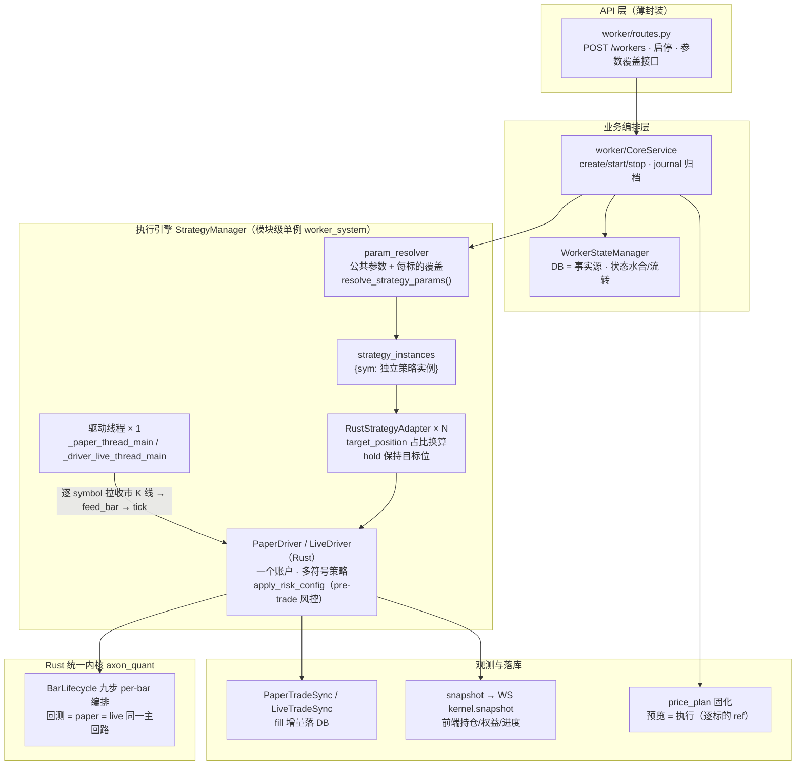
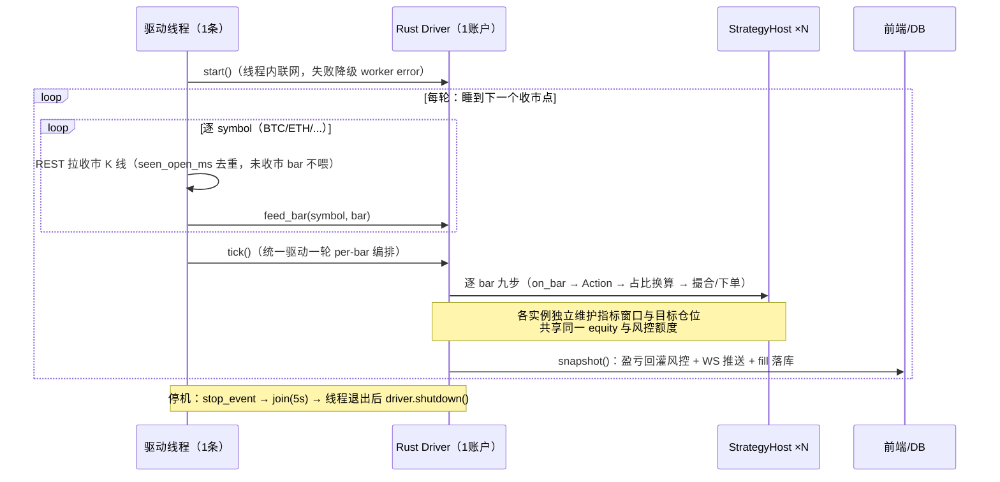
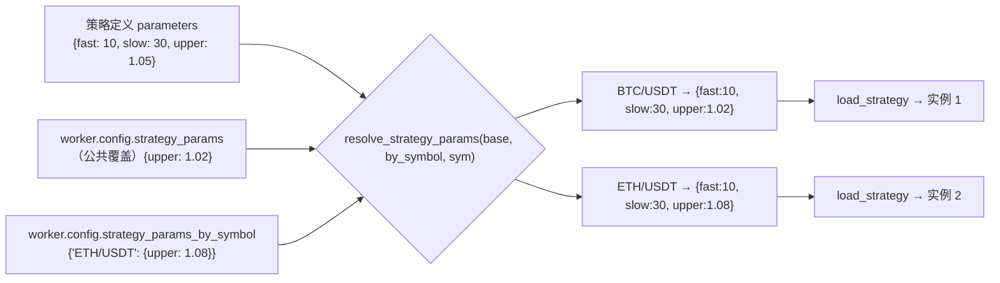

# Worker 模块实现原理与多标的执行架构

> 更新日期：2026-11-28（基于 2026-11-28 per-symbol-params 需求落地后的代码）
> 代码主体：`backend/worker/`（执行引擎在 `strategy_manager.py`，约 1800 行）

## 1. 模块总览：三层职责

```
API 路由层            worker/routes.py        薄封装：接参数、权限、异常翻译，零业务逻辑
业务编排层            worker/core_service.py  Worker CRUD / 启停编排 / journal 归档 / 状态收口
执行引擎（单例）      worker/strategy_manager.py  StrategyManager：策略装配 + 驱动线程 + 泵
```

辅助设施：

| 设施 | 文件 | 职责 |
|------|------|------|
| 状态事实源 | `worker_state.py` | DB 为事实源，`WorkerStateManager` 负责状态水合/流转（历史 ZMQ 多进程层已删除，启停全部进程内直调） |
| 内存注册表 | `state.py` | `StrategyRuntime`（worker_id → 运行态快照，含 pid/started_at） |
| 参数解析 | `strategy/param_resolver.py` | `resolve_strategy_params(base, by_symbol, symbol)` —— 公共参数与标的覆盖合并的唯一出口 |
| 内核桥接 | `strategy/rust_adapter.py` | `RustStrategyAdapter`：Python 策略 `on_bar → Action` 桥接为 Rust 内核 `StrategyHost` |
| 风控 | `risk_config.py` | `apply_risk_config`（pre-trade 风控，opt-in）、`RiskPnlFeeder`（权益→当日盈亏回灌） |
| 成交落库 | `paper_trade_sync.py` / `live_trade_sync.py` | 内核 fill 增量拉取落 DB |

## 2. 启动主流程（单/多标的共用）

`worker_system.start_strategy(worker_id, ref_price)` → `_do_start_strategy`：

1. **配置校验** `_validate_worker_config`：strategy_id 非空、config JSON 为 dict、策略参数为 dict
2. **参数解析**：读策略定义参数 + worker 级覆盖 → 得到 `params`（公共）
3. **统一防护** `_reject_feature_strategy_if_configured`：配置了因子特征的策略在 paper/live 无逐 bar 特征通道，启动即拒绝（防静默空转）
4. **按策略类型路由**：
   - **RL**：直接把模型注册进内核 RL host，**多标的只挂首标的**（warning + 路线图，见 §5）
   - **规则/LLM**：进入多标的逐实例装配（§3）
5. **价格计划固化** `_persist_worker_price_plan(by_symbol)`：预览 = 执行（同一纯函数 + 同一 ref_price）；逐标的 ref_price dict 由启动确认弹窗采集
6. **装配 driver + 启动驱动线程**（paper → `PaperDriver`；testnet → `LiveDriver`）
7. **统一收尾** `_finalize_start`：注册表 status=running + DB + worker_state 三处流转

## 3. 多标的 vs 单标的：核心差异

### 3.1 结论一句话

**「每标的一个独立策略实例，共享同一个账户与同一套风控」**。参数、指标窗口、持仓意图按标的隔离；资金、权益、风控额度按 worker 全局共享。

### 3.2 逐维度对比（规则/LLM 策略）

| 维度 | 单标的 | 多标的 |
|------|--------|--------|
| 策略实例 | 1 个 | **N 个独立实例**（`StrategyLoaderService.load_strategy(instrument_ids=[sym])` 逐标的加载，指标窗口/持仓状态互不可见） |
| 参数解析 | 公共 `params` 一份 | 每标的先过 `resolve_strategy_params(公共, strategy_params_by_symbol, sym)` —— 策略默认 < 公共参数 < 标的覆盖（None/'' 视同未覆盖），键经 `expand_symbol` 归一化（BTCUSDT → BTC/USDT） |
| driver 挂载 | `add_strategy(adapter, symbol)` 1 次 | 循环 N 次，每标的 1 个 `RustStrategyAdapter(instance, initial_cash, symbol=sym)` |
| 账户资金 | `initial_cash` 单池 | **同一个池**：`PaperDriver/LiveDriver` 用同一 `initial_cash` 构造，N 个 adapter 共享 equity |
| 风控 | `apply_risk_config` 一套 | 同一套（worker 级配置，opt-in）；当日盈亏回灌用**全账户权益**差值，不做跨标的分摊（V2 待实测项） |
| 驱动线程 / 泵 | 1 条，逐 symbol 拉 K 线 | **完全相同**——无 per-symbol 线程，见 §4 |
| 价格计划预览 | 单标的 ref_price | 逐标的 ref_price dict；缺键的标的目标仓位 pending，不强制折算 |
| RL 策略 | 完整支持 | **降级**：只挂 `symbols[0]`，启动打 warning（路线图第 1 项：RL 按标的执行） |
| 回测对照 | `engine_service` 单品种单次加载 | 多品种逐标的独立 resolve + 内核实例；有覆盖才逐标的加载，无覆盖保持单实例复用（防 3-load 假绿） |

### 3.3 为什么这样设计

- **实例隔离的必要性**：策略参数（如价格区间 lower/upper、均线窗口）语义随标的价格量级变化，全标的共用一份参数无法适配；独立实例让每个标的自己维护 `self.closes` 这类有状态窗口。
- **共享账户的必要性**：真实交易里账户余额就是一份；若每标的独立资金池，风控（当日最大亏损、总仓位上限）会失真。Rust 内核 driver 本身就是「一账户 + 多符号策略」模型，Python 侧只是在装配层把多实例挂进同一 driver。
- **单线程泵**：K 线闭环节拍由 timeframe 决定，一份时钟足矣；多标的只是泵轮内多拉几路 REST（逐 symbol 串行），把并发复杂度挡在内核外。

## 4. 架构图

### 4.1 分层与启动装配



### 4.2 多标的泵轮数据流（每个收市周期一轮）



### 4.3 参数解析链



合并优先级：**策略默认 < 公共 `strategy_params` < 标的覆盖**；覆盖值为 `None`/`''` 视同未覆盖回退公共值；标的键统一经 `expand_symbol` 归一化，写法差异（BTCUSDT / BTCUSDT / BTC-USDT）不影响命中。

## 5. paper / live / RL 三条路径

| | paper（规则/LLM） | testnet live（规则/LLM） | RL |
|---|---|---|---|
| driver | `axon_worker.PaperDriver`（testnet 公共行情 + 内置撮合） | `axon_worker.LiveDriver`（Binance USDT-M 合约测试网） | 同左两者，挂 RL host |
| 多标的 | 逐实例挂载 | 逐实例挂载（与 paper 同口径） | **仅 `symbols[0]`** + warning |
| 驱动 | `_paper_thread_main`（拉 testnet 收市 K 线喂 bar） | `_driver_live_thread_main`（WS/REST 真实行情） | 同左 |
| 成交同步 | `PaperTradeSync` | `LiveTradeSync` + 周期对账（6h）+ 资金费对账（30h 窗口） | 同左 |
| 持久化 | 无 journal（账纯内存） | `journal` 逐笔记录，支持幂等 resume | journal |
| 凭证 | 不需要 | `credentials_account` 参数优先，回退系统配置测试网 Key | 同左 |

主网 live 全部三类策略均闸门拒绝（设计文档 §9.4，testnet 对账通过前不放行）。

## 6. 边界与已知限制

1. **RL 多标的**：只挂首标的（`_do_start_strategy` L486-492），路线图第 1 项为 RL 按标的执行——依赖模型 obs 与 per-symbol 特征通道设计，非装配层改动即可完成。
2. **V2 风控跨标的聚合**：风控额度按全账户权益判定已生效，但「单标的敞口上限 vs 总敞口上限」的跨标的分摊口径未在多标的环境实跑验证。
3. **V3 journal resume 多标的恢复**：live 中断后按 journal 幂等恢复的路径，多标的场景未实跑。
4. **因子特征策略**：paper/live 无逐 bar 特征注入通道，启动即拒绝（前端引导改用回测）。
5. **paper 漏 bar 补拉**：泵异常轮后固定回看 50 根（`PAPER_CATCHUP_LIMIT`），1m 周期约覆盖 50 分钟；更长的中断靠重启时首轮全量重置观测窗口（ponytail 注释记录了该上限与升级路径）。

## 7. 关键文件索引

| 文件 | 关键符号 |
|------|----------|
| `backend/worker/strategy_manager.py` | `StrategyManager` 单例、`_do_start_strategy`（L379 主流程）、`_assemble_rule_paper_driver`（L620）、`start_crypto_live`（L947）、`_paper_thread_main`（L1501）、`_paper_pump_round`（L1601）、`stop_strategy`（L1788） |
| `backend/strategy/param_resolver.py` | `resolve_strategy_params` / `normalize_symbol_key` |
| `backend/strategy/rust_adapter.py` | `RustStrategyAdapter`（BaseStrategy → 内核 StrategyHost） |
| `backend/worker/core_service.py` | `WorkerCoreService`（CRUD/启停编排/journal 归档） |
| `backend/worker/worker_state.py` | `WorkerStateManager`（DB 事实源 + 惰性水合） |
| `backend/worker/risk_config.py` | `apply_risk_config` / `RiskPnlFeeder` |
| `backend/backtest/engine_service.py` | 回测侧对照：`strategy_params_by_symbol` 逐标的加载 |
