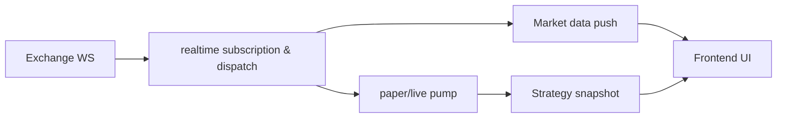

# WebSocket Realtime Channels

QuantCell pushes realtime data from the backend to the frontend over
WebSocket, mainly carrying:

- **Realtime market data**: exchange WebSocket → realtime module →
  frontend charts
- **Strategy snapshots**: paper / live pump threads push position, equity
  and fill snapshots via event callbacks
- **Research channel**: `/ws/research` carries progress and result streams
  for factor analysis and research jobs

## Connection

```text
ws://localhost:8000/ws/research
```

In production this corresponds to the WebSocket endpoint under your domain;
authentication is the same as the REST side.

## Where it sits in the data flow



## Message format

Pushed messages are JSON with a type field distinguishing event kinds
(market tick / snapshot / research progress, etc.). For exact payloads,
refer to each endpoint's Swagger and the frontend request code.

## Related docs

- [Paper & Live Trading](../user-guide/live-trading.md) — where snapshots originate
- [Data Ecosystem](../user-guide/data.md) — the realtime subscription & dispatch module
