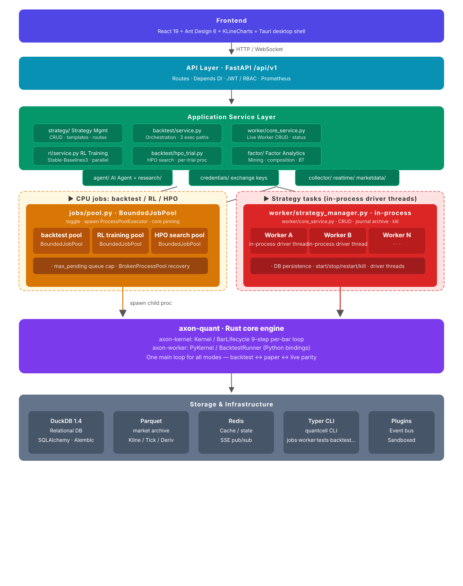
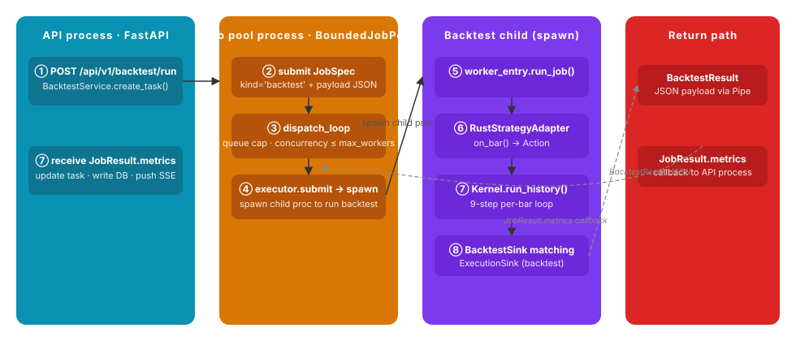
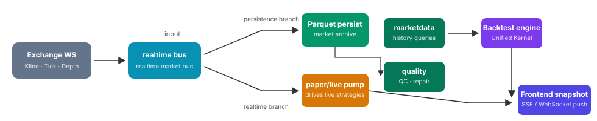

# Architecture

## System layers



> **Jobs (job pool) vs Worker (live strategy process)** — two separate scheduling concepts with disjoint boundaries:
>
> | | Jobs job pool | Worker live strategy process |
> |---|---|---|
> | **Purpose** | CPU concurrency scheduling for backtest / RL training / HPO search | Live strategy instances (each Worker = one strategy + one exchange + one trading pair) |
> | **Lifecycle** | spawn child process → exits when the job finishes | Long-running process (DB + journal persistence, start/stop/restart/kill) |
> | **Communication** | shared memory + `JobResult` return | ZMQ Orchestrator (5558/5559) |
> | **Config** | 3-state toggle + core pinning (`[jobs].cores`) | per-Worker `trading_config` / credentials |
> | **CLI** | `quantcell jobs config / selftest` (no pool created) | `quantcell worker summary/start/stop/...` (requires the ZMQ channel) |

## Unified main loop (backtest / paper / live)

QuantCell's most important architectural decision: **all three modes run the same main loop**.

- The main loop is driven by the **unified kernel** (Rust), executing the per-bar orchestration
- Mode differences live only in the **wiring layer**:
    - **Data pump**: backtests replay historical frames; paper / live use the realtime KernelPump
    - **Execution layer**: backtests fill via `BacktestSink`, paper simulates via `PaperSink`, live uses the real execution sink
- The main loop itself has no mode branches, guaranteeing **identical behavior between backtest and live trading**

### Unified kernel scheduling path (backtest example)



### Strategy output contract

Every strategy emits the same unified `Action`; risk control and execution both operate on this single contract:

```python
from strategy.core import Action, ActionType

action = Action(
    action_type=ActionType.Buy,   # Buy / Sell / Hold / ReduceLong / ReduceShort
    confidence=0.8,
    target_position=0.1,          # target position as a share of equity
    model_id="dual_ma",
    inference_time_us=0,
)
```

## Backend layout

| Directory | Responsibility |
|------|------|
| `backend/strategy/` | Strategy base classes, templates, routes, LLM decision recording & replay |
| `backend/backtest/` | Backtest orchestration (unified kernel / legacy / Python — three execution paths) |
| `backend/worker/` | Worker system (StrategyManager core singleton + paper/live pump threads) |
| `backend/realtime/` | Realtime market data subscription, distribution and persistence |
| `backend/collector/` | Exchange data collection and archiving |
| `backend/marketdata/` | Market data service |
| `backend/quality/` | Data quality checks and repair |
| `backend/credentials/` | Encrypted exchange credential storage |
| `backend/agent/` | AI Agent (memory + tool calling) |
| `backend/research/` | Research module (factors, snapshots, etc.) |
| `backend/factor/` | Factor analytics |
| `backend/rl/` | Reinforcement learning service |
| `backend/ai/` | AI model integration |
| `backend/mcp_server/` | MCP server |
| `backend/observability/` | Prometheus metrics and health checks |
| `backend/extensions/` | System capability switches |
| `backend/config/` | Configuration management (pydantic-settings) |
| `backend/tools/` | Utility functions |
| `backend/strategies/` | User-defined strategies (one directory per strategy) |
| `backend/plugins/` | Plugin foundation (event bus + sandbox) |

## Backend tech stack

| Category | Technology |
|------|------|
| Language | Python 3.14 |
| Web framework | FastAPI 0.136 (uvicorn) |
| Trading engine | Rust core (PyO3, path dependency) |
| Database | DuckDB 1.4 + Parquet + SQLAlchemy 2 + Alembic |
| Data processing | Pandas 2.3 / PyArrow 22 |
| Reinforcement learning | Gymnasium 1.3 + Stable-Baselines3 2.9 |
| CLI | Typer 0.20 |
| Code style | ruff (lint + format) |
| Testing | pytest 9 + coverage (coverage baseline 57%) |

## Frontend tech stack

| Category | Technology |
|------|------|
| Framework | React 19 + TypeScript 5.9 + Vite 8 |
| UI | Ant Design 6 + TailwindCSS 4 |
| Charts | KLineCharts 10 + ECharts 5.5 |
| State | Zustand 5 |
| i18n | i18next / react-i18next |
| Editor | Monaco |

## Desktop

The desktop client reuses the same frontend code inside a **Tauri 2** shell; the backend is packaged
by **PyInstaller** as a sidecar process started with the desktop app. It supports `local`
(backend not required, no login) and `remote` (connect to a backend service) modes.
See [desktop client](desktop.md).

## Data flow


