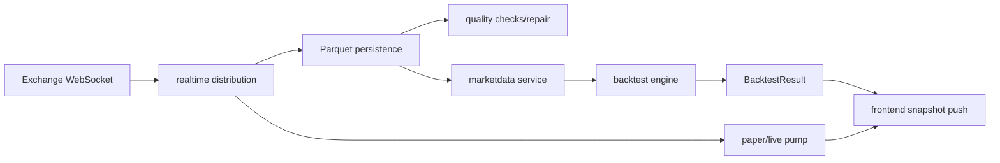

# Architecture

## System layers

```
┌──────────────────────────────────────────────────────────┐
│                  Frontend (React + TypeScript)            │
│    Ant Design 6 · KLineCharts · Zustand · i18n · Tauri   │
└──────────────────────────┬───────────────────────────────┘
                           │ HTTP / WebSocket
┌──────────────────────────▼───────────────────────────────┐
│                API Layer (FastAPI, /api/v1)               │
│  CORS · Auth · Error handling · Capabilities · Metrics    │
└──────┬───────────────┬────────────────┬───────────────────┘
       │               │                │
       ▼               ▼                ▼
┌─────────────┐  ┌─────────────┐  ┌─────────────┐
│ Strategy &  │  │ Live/Real-  │  │ Data        │
│ Backtest    │  │ time        │  │ Collection  │
│ strategy/   │  │ realtime/   │  │ collector/  │
│ backtest/   │  │ worker/     │  │ quality/    │
│ factor/ rl  │  │ credentials │  │ marketdata/ │
└──────┬──────┘  └──────┬──────┘  └──────┬──────┘
       │                │                │
       ▼                ▼                ▼
┌──────────────────────────────────────────────────────────┐
│           Rust kernel · Binance / OKX · DuckDB           │
│    Backtest / paper / live share one per-bar main loop    │
└──────────────────────────────────────────────────────────┘
       ▲                ▲                ▲
┌──────┴──────┐  ┌──────┴──────┐  ┌──────┴──────┐
│    Agent    │  │    CLI      │  │   Plugins   │
│   agent/    │  │  quantcell  │  │  plugins/   │
│  research/  │  │ 15 groups   │  │  Event bus  │
└─────────────┘  └─────────────┘  └─────────────┘
```

## Unified main loop (backtest / paper / live)

QuantCell's most important architectural decision: **all three modes run the
same main loop**.

- The main loop is driven by the Rust **Kernel**, executing
  per-bar orchestration
- Modes differ only at the **assembly layer**:
    - **Data pump**: backtests replay historical frames; paper / live use the real-time KernelPump
    - **Execution sink**: backtests match on `BacktestSink`, paper on `PaperSink`, live on a real trading sink
- The main loop itself has no mode branches, guaranteeing **backtest and live
  behave identically**

```
Strategy (on_bar → Action)
        │
        ▼
┌─────────────────────────────────────┐
│           unified Kernel            │
│   Nine-step per-bar orchestration    │
│   data → signal → risk → matching    │
└─────────────────────────────────────┘
        │
        ▼
   ExecutionSink (backtest / paper / live — pick one)
```

### Strategy output contract

All strategies emit a unified `Action`; both the risk engine and execution
layer operate on the same contract:

```python
from strategy.core import Action, ActionType

action = Action(
    action_type=ActionType.Buy,   # Buy / Sell / Hold / ReduceLong / ReduceShort
    confidence=0.8,
    target_position=0.1,          # target position as fraction of equity
    model_id="dual_ma",
    inference_time_us=0,
)
```

## Backend layout

| Directory | Responsibility |
|-----------|----------------|
| `backend/strategy/` | Strategy base classes, templates, routes, LLM decision record & replay |
| `backend/backtest/` | Backtest orchestration (unified kernel / legacy / Python paths) |
| `backend/worker/` | Worker system (StrategyManager singleton + paper/live pump threads) |
| `backend/realtime/` | Real-time market subscription, distribution, persistence |
| `backend/collector/` | Exchange data collection & archiving |
| `backend/marketdata/` | Market data service |
| `backend/quality/` | Data quality checks & repair |
| `backend/credentials/` | Encrypted exchange credential storage |
| `backend/agent/` | AI Agent (memory + tool calling) |
| `backend/research/` | Research module (snapshots etc.) |
| `backend/factor/` | Factor analytics |
| `backend/rl/` | Reinforcement learning service |
| `backend/ai/` | AI model integration |
| `backend/mcp_server/` | MCP server |
| `backend/observability/` | Prometheus metrics & health |
| `backend/extensions/` | Capability switches |
| `backend/config/` | Configuration management (pydantic-settings) |
| `backend/tools/` | Utility functions |
| `backend/strategies/` | User-defined strategies (one directory per strategy) |
| `backend/plugins/` | Plugin foundation (event bus + sandbox) |

## Backend tech stack

| Category | Technology |
|----------|------------|
| Language | Python 3.14 |
| Web framework | FastAPI 0.136 (uvicorn) |
| Trading engine | Rust core (PyO3, path dependency) |
| Database | DuckDB 1.4 + Parquet + SQLAlchemy 2 + Alembic |
| Data processing | Pandas 2.3 / PyArrow 22 |
| Reinforcement learning | Gymnasium 1.3 + Stable-Baselines3 2.9 |
| CLI | Typer 0.20 |
| Code style | ruff (lint + format) |
| Testing | pytest 9 + coverage (coverage baseline 57%) |

## Frontend tech stack

| Category | Technology |
|----------|------------|
| Framework | React 19 + TypeScript 5.9 + Vite 8 |
| UI | Ant Design 6 + TailwindCSS 4 |
| Charts | KLineCharts 10 + ECharts 5.5 |
| State | Zustand 5 |
| i18n | i18next / react-i18next |
| Editor | Monaco |

## Desktop

The desktop app is a **Tauri 2** shell reusing the same frontend code; the
backend is packaged with **PyInstaller** as a sidecar process launched by the
desktop app. Supports `local` (bundled backend, no login) and `remote`
(connect to a remote server) modes. See [Desktop client](desktop.md).

## Data flow


