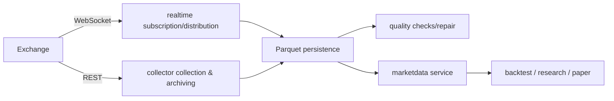

# Data Ecosystem

## Overall pipeline



## Exchange adapters

- **Binance**: live, paper (testnet), and archive environment adapters
- **OKX**: spot / perpetual market data and trading

Collected data types are unified as "aggregated into bar shape", covering 10
data sources (klines, funding, mark price, trades, order book, etc.).

## Real-time market data (realtime/)

- WebSocket subscription to exchange market data with unified event distribution
- Consumed by paper / live pump threads and the frontend live charts
- Structurally identical to historical data, so live / backtest switch seamlessly

## Storage

- **DuckDB 1.4**: local analytical database for strategy / backtest / research structured data
- **Parquet**: columnar market data storage — high compression, efficient point and bulk reads
- **SQLAlchemy 2 + Alembic**: relational storage for business metadata and schema migrations

## Data quality (quality/)

```bash
quantcell data quality check --start 20240101 --end 20241231
```

- **Missing-value detection**: scans holes per symbol per interval
- **Automatic re-download**: re-pulls missing ranges from the exchange
- **Archive repair**: fixes broken archives caused by interrupted collection

## Market data service (marketdata/)

REST endpoints serve market data by symbol / interval / time range (mounted
under `/api/v1/marketdata`), with a response shape matching backtest inputs —
directly reusable in research.

## CLI cheat sheet

| Task | Command |
|------|---------|
| Download data | `quantcell data download -s BTCUSDT -i 1d` |
| Quality check | `quantcell data quality check --start 20240101 --end 20241231` |
| Import CSV | `quantcell data import csv <file>` |
| Fetch market data | `quantcell market fetch --symbol BTCUSDT --interval 1h` |
| News & sentiment | `quantcell news ...` |
| Web search / scraping | `quantcell web ...` |
| Factor analytics | `quantcell factor ...` (analysis / compare / synthetic / LLM mining / snapshot) |

## Data conventions

- Timestamps are **nanosecond-precision ISO 8601 (RFC 3339)**, keeping all trailing zeros
- Symbols are unified as `BASE/QUOTE` (e.g. `BTC/USDT`); adapter-level mapping
  handles exchange-specific symbols
