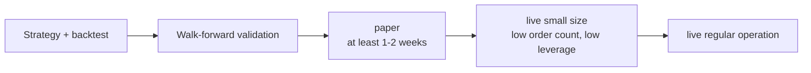

# Paper & Live Trading

## Worker system

paper / live are managed by `worker_system` (the `StrategyManager` singleton):

- Strategy lifecycle management (register, start, stop)
- Injection of the exchange adapter and risk engine
- Pump threads drive bars in real time, bridging history and live data

```python
from worker.strategy_manager import worker_system

worker_system.engine_status()          # engine overview (exchange / mode / risk / strategy count)
worker_system.register_strategy(...)   # register a strategy
worker_system.list_strategies()        # list strategies
```

## Paper and live differ by one layer

paper / live also run the unified-kernel main loop; the only difference from a
backtest is the **ExecutionSink**:

| Mode | Data source | ExecutionSink | Notes |
|------|-------------|---------------|-------|
| backtest | historical bar replay | `BacktestSink` | local matching, deterministic |
| paper | real-time orders (KernelPump) | `PaperSink` | simulated matching, validates strategy not capital |
| live | real-time data (KernelPump) | `LiveSink` | real orders, highest fidelity |

Callbacks push snapshots to the frontend for real-time monitoring.

> Mechanically paper and live share the same signal, risk, and order
> representation; the real differences are **capital truthfulness** and
> **execution truthfulness**.

## Risk engine

Configure the risk engine (injected inside `worker/`) before going live:

- Trading risk metric monitoring (drawdown, exposure, frequency)
- Stop-loss and position controls
- Every order passes risk checks before reaching the exchange

## Credential management

Exchange API keys are **stored encrypted** and managed via the CLI:

```bash
quantcell account add            # interactive entry (exchange / api_key / secret)
quantcell account list           # list configured credentials (masked)
```

Security rules:

- Keys are never written in plain text or logs
- Structured logging automatically filters sensitive fields
- On the exchange side, grant trading permissions only — keep withdrawal disabled

## Recommended path to live



Each step has explicit pass criteria (e.g. controlled paper drawdown, slippage
within expectation) before progressing.

## Monitoring & observability

- **Prometheus metrics**: `/metrics` endpoint (when the capability switch is on)
- **Health check**: `/health`
- **Frontend live push**: strategy state, positions, and fills visible via WebSocket snapshots
- **Structured logs**: request_id included for end-to-end tracing (see [best practices](../best-practices.md))
