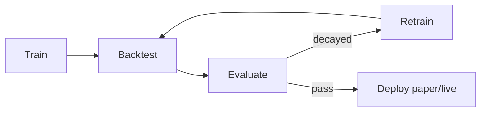

# Reinforcement Learning

## Components

- **Gymnasium trading environment**: a built-in trading Gym that models price
  series, positions, and PnL as an MDP (state / action / reward)
- **Stable-Baselines3 2.9**: mainstream algorithms out of the box — PPO / SAC / DQN
- **RL service**: full lifecycle management for training, backtesting,
  evaluation, and retraining (`backend/rl/`)

## Training environment

```python
from strategy.core import TradingEnv
from stable_baselines3 import PPO

env = TradingEnv(config={...}, action_space="discrete",
                 market_data=df, reward="sharpe")
model = PPO("MlpPolicy", env)
model.learn(total_timesteps=10_000)
```

- `action_space`: `discrete` or continuous
- `reward`: built-in reward functions including Sharpe, return, and drawdown penalties

## CLI training

```bash
quantcell rl train \
    -s BTCUSDT \
    -a ppo \
    -t 100000 \
    -r sharpe
```

| Parameter | Description |
|-----------|-------------|
| `-s` | symbol |
| `-a` | algorithm: ppo / sac / dqn |
| `-t` | total training steps |
| `-r` | reward function |

## One-shot lifecycle

```bash
quantcell rl lifecycle -s BTCUSDT --train-steps 30000 --retrain-steps 10000
```

The lifecycle covers the full closed loop, with walk-forward validation support:



## Caveats

- RL strategies are especially prone to overfitting — **always** run
  walk-forward validation (see [Backtesting](backtesting.md))
- Keep training and validation data strictly separated to avoid information leakage
- The reward function shapes strategy behavior; start simple, add constraints later
