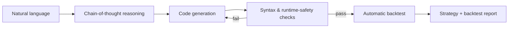

# Strategy Development

QuantCell offers three strategy development paths that all converge on the
same output contract (`on_bar → Action`) and the same backtest engine:

1. **AI generation** (recommended): natural language → generated, validated, backtested
2. **Strategy templates**: 13 built-in templates, parameterize and run
3. **Custom development**: subclass the base class and write everything yourself

## Strategy output contract

Every strategy implements the same interface: it is called once per closed
bar and returns an `Action`.

```python
from axon_quant import Action, ActionType

class MyStrategy:
    def on_bar(self, bar: dict) -> Action:
        self.closes.append(bar["close"])
        # ... compute signal ...
        return Action(ActionType.Buy, 0.8, 0.1, model_id="my_strategy",
                      inference_time_us=0)
```

`ActionType` has five variants: `Buy` / `Sell` / `Hold` / `ReduceLong` /
`ReduceShort`. `target_position` is the target position as a fraction of
equity, converted to absolute quantity by the execution layer.

## Path 1: AI generation

From the CLI:

```bash
quantcell strategy generate \
  --requirement "dual moving-average trend following: fast 10 days, slow 30 days, buy on golden cross, sell on death cross" \
  --name dual_ma
```

From the frontend: describe the idea in the chat UI — the AI Agent runs the
same generation pipeline.

Internal flow:



Safety validation rejects dangerous code (file writes, network access, etc.);
code that fails validation never lands on disk.

## Path 2: Strategy templates

The 13 built-in templates live in `backend/strategy/templates/`:

| Template | Description |
|----------|-------------|
| `dual_ma.py` | Dual moving-average crossover |
| `sma_crossover.py` | SMA crossover |
| `grid.py` | Grid trading |
| `mean_reversion.py` | Mean reversion |
| `momentum.py` | Momentum |
| `trend_follow.py` | Trend following |
| `cascade_signal.py` | Cascade signal |
| `cross_sectional.py` | Cross-sectional |
| `factor_timing.py` | Factor timing |
| `funding_arbitrage.py` | Funding rate arbitrage |
| `llm_signal.py` | LLM signal |
| `martingale.py` | Martingale |
| `mean_reversion_rl.py` | RL mean reversion |

Templates can be backtested with parameters directly:

```python
from backtest.engine_service import EventDrivenBacktestService
from backtest.data_provider import BacktestDataProvider

service = EventDrivenBacktestService(BacktestDataProvider())
result = service.run_backtest(
    strategy_name="dual_ma",
    strategy_params={"fast": 10, "slow": 30},
    symbols=["BTCUSDT"],
    timeframes=["1h"],
    engine_config={"initial_capital": 100_000},
    data_type="kline",
    market="spot",
)
```

## Path 3: Custom development

Custom strategies live in `backend/strategies/<strategy-name>/` — one
standalone directory per strategy, nowhere else (the framework discovers
strategies by directory).

Key rules:

- Implement `on_bar(bar: dict) -> Action`; bar is a nanosecond-timestamped
  OHLCV dict
- Strategies only compute **signals**: no order placement, no network
  access — matching and risk control belong to the engine
- Parameters come in via `strategy_params`; keep the strategy stateless or
  limited to a sliding window

## LLM strategies: record & replay

Strategies with `mode='llm'` are **forbidden from making real LLM calls during
backtests**:

- In paper / live, `RecordingProvider` records LLM decisions to JSONL
  (default directory `backend/data/llm_replay`, redirect with
  `QUANTCELL_LLM_REPLAY_DIR`)
- In backtests, `ReplayProvider` looks up recorded decisions only and
  **raises on a miss** — it never degrades to heuristics or Hold

This keeps backtests deterministic and reproducible with zero LLM cost.

## Validation loop

The standard flow for shipping a strategy:

```bash
quantcell strategy list                      # confirm the strategy is registered
quantcell backtest run -s my_strategy \
  --symbols BTCUSDT --timeframes 1h          # base backtest
```

Then continue with walk-forward validation and hyperparameter optimization
(see [Backtesting](backtesting.md)) before moving to
[paper → live](live-trading.md).
