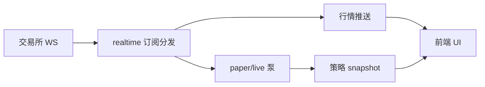

# WebSocket 实时通道

QuantCell 通过 WebSocket 把实时数据从后端推送到前端，主要承载：

- **实时行情**：交易所 WebSocket → realtime 模块 → 前端 K 线图
- **策略快照**：paper / live 泵线程在事件回调中推送持仓、权益、成交快照
- **研究通道**：`/ws/research` 承载因子分析、研究任务的进度与结果流

## 连接

```text
ws://localhost:8000/ws/research
```

生产环境对应域名下的 WebSocket 端点；认证方式与 REST 侧一致。

## 数据流位置



## 消息格式

推送消息为 JSON，携带类型字段区分事件种类（行情 tick / snapshot / 研究进度等）。
具体 payload 以各端点的 Swagger 与前端请求代码为准。

## 相关文档

- [模拟盘与实盘](../user-guide/live-trading.md) —— snapshot 推送的来源
- [数据生态](../user-guide/data.md) —— realtime 订阅分发模块
