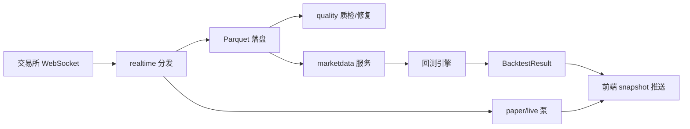

# 架构总览

## 系统分层

```
┌──────────────────────────────────────────────────────────┐
│                  前端 (React + TypeScript)                │
│    Ant Design 6 · KLineCharts · Zustand · i18n · Tauri   │
└──────────────────────────┬───────────────────────────────┘
                           │ HTTP / WebSocket
┌──────────────────────────▼───────────────────────────────┐
│                API Layer (FastAPI, /api/v1)               │
│  CORS · 认证 · 异常处理 · 能力开关 · Prometheus 可观测     │
└──────┬───────────────┬────────────────┬───────────────────┘
       │               │                │
       ▼               ▼                ▼
┌─────────────┐  ┌─────────────┐  ┌─────────────┐
│ 策略与回测   │  │ 实时交易     │  │ 数据采集     │
│ strategy/   │  │ realtime/   │  │ collector/  │
│ backtest/   │  │ worker/     │  │ quality/    │
│ factor/ rl  │  │ credentials │  │ marketdata/ │
└──────┬──────┘  └──────┬──────┘  └──────┬──────┘
       │                │                │
       ▼                ▼                ▼
┌──────────────────────────────────────────────────────────┐
│      axon-quant (Rust 内核) · Binance / OKX · DuckDB     │
│      回测 / paper / live 共用统一 per-bar 主回路           │
└──────────────────────────────────────────────────────────┘
       ▲                ▲                ▲
┌──────┴──────┐  ┌──────┴──────┐  ┌──────┴──────┐
│    Agent    │  │    CLI      │  │    插件      │
│   agent/    │  │  quantcell  │  │  plugins/   │
│  research/  │  │  15 组命令   │  │  事件总线    │
└─────────────┘  └─────────────┘  └─────────────┘
```

## 统一主回路（回测 / paper / live）

QuantCell 最重要的架构决策：**三种模式跑同一条主回路**。

- 主回路由 `axon-quant`（Rust）的 **Kernel** 驱动，执行 per-bar 编排
- 模式差异只在**装配层**：
    - **数据泵**：回测用历史帧回放，paper / live 用实时 KernelPump
    - **执行层**：回测用 `BacktestSink` 撮合，paper 用 `PaperSink` 模拟，live 用实盘 sink
- 主回路本身没有 mode 分支，保证**回测与实盘行为一致**

```
策略 (on_bar → Action)
        │
        ▼
┌─────────────────────────────────────┐
│         axon-quant Kernel            │
│   九步 per-bar 编排（每根 K 线）     │
│   数据更新 → 信号 → 风控 → 撮合      │
└─────────────────────────────────────┘
        │
        ▼
   ExecutionSink（回测 / paper / live 三选一）
```

### 策略输出契约

所有策略输出统一的 `Action`，风控与执行层都基于同一契约运作：

```python
from axon_quant import Action, ActionType

action = Action(
    action_type=ActionType.Buy,   # Buy / Sell / Hold / ReduceLong / ReduceShort
    confidence=0.8,
    target_position=0.1,          # 目标仓位（权益占比）
    model_id="dual_ma",
    inference_time_us=0,
)
```

## 目录结构（后端）

| 目录 | 职责 |
|------|------|
| `backend/strategy/` | 策略基类、模板、路由、LLM 决策录制回放 |
| `backend/backtest/` | 回测编排（统一内核 / legacy / Python 三条执行路径） |
| `backend/worker/` | worker 系统（StrategyManager 核心单例 + paper/live 泵线程） |
| `backend/realtime/` | 实时行情订阅、分发与持久化 |
| `backend/collector/` | 交易所数据采集与归档 |
| `backend/marketdata/` | 市场数据服务 |
| `backend/quality/` | 数据质量检测与修复 |
| `backend/credentials/` | 交易所凭证加密存储 |
| `backend/agent/` | AI Agent（记忆 + 工具调用） |
| `backend/research/` | 研究模块（因子、快照等） |
| `backend/factor/` | 因子分析 |
| `backend/rl/` | 强化学习服务 |
| `backend/ai/` | AI 模型接入 |
| `backend/mcp_server/` | MCP server |
| `backend/observability/` | Prometheus 指标与健康检查 |
| `backend/extensions/` | 系统能力开关 |
| `backend/config/` | 配置管理（pydantic-settings） |
| `backend/tools/` | 工具函数 |
| `backend/strategies/` | 用户自定义策略（每策略独立目录） |
| `backend/plugins/` | 插件基座（事件总线 + 沙箱） |

## 后端技术栈

| 类别 | 技术 |
|------|------|
| 语言 | Python 3.14 |
| Web 框架 | FastAPI 0.136（uvicorn） |
| 交易引擎 | axon-quant 0.25.0（Rust 核心，path 依赖） |
| 数据库 | DuckDB 1.4 + Parquet + SQLAlchemy 2 + Alembic |
| 数据处理 | Pandas 2.3 / PyArrow 22 |
| 强化学习 | Gymnasium 1.3 + Stable-Baselines3 2.9 |
| CLI | Typer 0.20 |
| 代码规范 | ruff（lint + format） |
| 测试 | pytest 9 + coverage（覆盖率基线 57%） |

## 前端技术栈

| 类别 | 技术 |
|------|------|
| 框架 | React 19 + TypeScript 5.9 + Vite 8 |
| UI | Ant Design 6 + TailwindCSS 4 |
| 图表 | KLineCharts 10 + ECharts 5.5 |
| 状态 | Zustand 5 |
| 国际化 | i18next / react-i18next |
| 编辑器 | Monaco |

## 桌面端

桌面端基于 **Tauri 2** 壳复用同一套前端代码，后端通过 **PyInstaller** 打包为
sidecar 进程随桌面端启动。支持 `local`（本地后端，免登录）与 `remote`
（连接远端服务）两种模式。详见[桌面客户端](desktop.md)。

## 数据流


