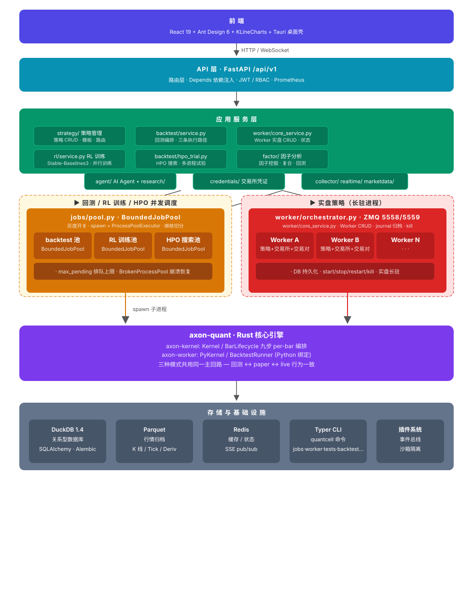
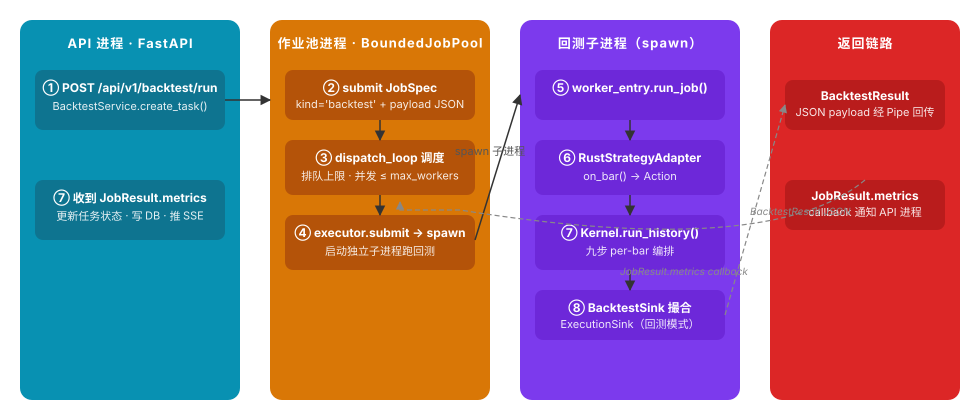
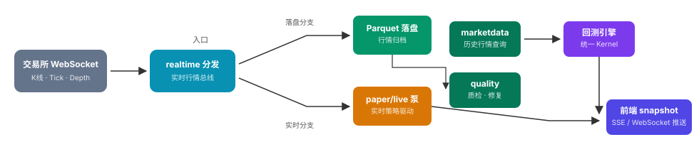

# 架构总览

## 系统分层




> **Jobs（作业池） vs Worker（实盘策略进程）** — 这是两个独立的调度概念，边界不相交：
>
> | | Jobs 作业池 | Worker 实盘策略进程 |
> |---|---|---|
> | **作用** | 回测 / RL 训练 / HPO 搜索 的 CPU 并发调度 | 实盘策略实例（每个 Worker = 一个策略 + 交易所 + 交易对） |
> | **生命周期** | spawn 子进程 → 跑完即死 | 长驻进程（DB + journal 持久化，start/stop/restart/kill） |
> | **通信** | 共享内存 + JobResult 回传 | 进程内直调（worker_system 单例 + 驱动线程） |
> | **配置** | 三态灰度开关 + 绑核切分（`[jobs].cores`） | 每 Worker 独立配置 trading_config / credentials |
> | **CLI** | `quantcell jobs config / selftest`（不建池） | `quantcell worker summary/start/stop/...`（进程内直调；API 未运行时走 DB pid 兜底） |

## 统一主回路（回测 / paper / live）

QuantCell 最重要的架构决策：**三种模式跑同一条主回路**。

- 主回路由 Rust 内核的 **Kernel** 驱动，执行 per-bar 编排
- 模式差异只在**装配层**：
    - **数据泵**：回测用历史帧回放，paper / live 用实时 KernelPump
    - **执行层**：回测用 `BacktestSink` 撮合，paper 用 `PaperSink` 模拟，live 用实盘 sink
- 主回路本身没有 mode 分支，保证**回测与实盘行为一致**

### 统一内核调度路径（回测为例）



### 策略输出契约

所有策略输出统一的 `Action`，风控与执行层都基于同一契约运作：

```python
from strategy.core import Action, ActionType

action = Action(
    action_type=ActionType.Buy,   # Buy / Sell / Hold / ReduceLong / ReduceShort
    confidence=0.8,
    target_position=0.1,          # 目标仓位（权益占比）
    model_id="dual_ma",
    inference_time_us=0,
)
```

## 目录结构（后端）

| 目录 | 职责 |
|------|------|
| `backend/strategy/` | 策略基类、模板、路由、LLM 决策录制回放 |
| `backend/backtest/` | 回测编排（统一内核 / legacy / Python 三条执行路径） |
| `backend/worker/` | worker 系统（StrategyManager 核心单例 + paper/live 泵线程） |
| `backend/realtime/` | 实时行情订阅、分发与持久化 |
| `backend/collector/` | 交易所数据采集与归档 |
| `backend/marketdata/` | 市场数据服务 |
| `backend/quality/` | 数据质量检测与修复 |
| `backend/credentials/` | 交易所凭证加密存储 |
| `backend/agent/` | AI Agent（记忆 + 工具调用） |
| `backend/research/` | 研究模块（因子、快照等） |
| `backend/factor/` | 因子分析 |
| `backend/rl/` | 强化学习服务 |
| `backend/ai/` | AI 模型接入 |
| `backend/mcp_server/` | MCP server |
| `backend/observability/` | Prometheus 指标与健康检查 |
| `backend/extensions/` | 系统能力开关 |
| `backend/config/` | 配置管理（pydantic-settings） |
| `backend/tools/` | 工具函数 |
| `backend/strategies/` | 用户自定义策略（每策略独立目录） |
| `backend/plugins/` | 插件基座（事件总线 + 沙箱） |

## 后端技术栈

| 类别 | 技术 |
|------|------|
| 语言 | Python 3.14 |
| Web 框架 | FastAPI 0.136（uvicorn） |
| 交易引擎 | Rust 核心（PyO3，path 依赖） |
| 数据库 | DuckDB 1.4 + Parquet + SQLAlchemy 2 + Alembic |
| 数据处理 | Pandas 2.3 / PyArrow 22 |
| 强化学习 | Gymnasium 1.3 + Stable-Baselines3 2.9 |
| CLI | Typer 0.20 |
| 代码规范 | ruff（lint + format） |
| 测试 | pytest 9 + coverage（覆盖率基线 57%） |

## 前端技术栈

| 类别 | 技术 |
|------|------|
| 框架 | React 19 + TypeScript 5.9 + Vite 8 |
| UI | Ant Design 6 + TailwindCSS 4 |
| 图表 | KLineCharts 10 + ECharts 5.5 |
| 状态 | Zustand 5 |
| 国际化 | i18next / react-i18next |
| 编辑器 | Monaco |

## 桌面端

桌面端基于 **Tauri 2** 壳复用同一套前端代码，后端通过 **PyInstaller** 打包为
sidecar 进程随桌面端启动。支持 `local`（本地后端，免登录）与 `remote`
（连接远端服务）两种模式。详见[桌面客户端](desktop.md)。

## 数据流



