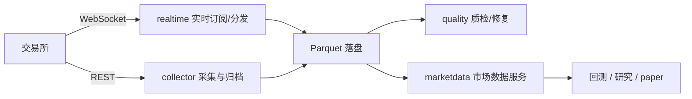

# 数据生态

## 总体链路



## 交易所适配

- **Binance**：实盘、纸面（testnet）、归档三种环境适配器
- **OKX**：现货 / 永续行情与交易

采集的数据类型按「聚合为 bar 形状」统一处理，支持 10 类数据源（K 线、
资金费、标记价格、逐笔成交、订单簿等）。

## 实时行情（realtime/）

- WebSocket 实时订阅交易所行情，统一事件分发
- 行情同时供 paper / live 泵线程与前端实时图表消费
- 与历史数据结构一致，实盘 / 回测无缝切换

## 存储

- **DuckDB 1.4**：本地分析型数据库，承载策略 / 回测 / 研究的结构化数据
- **Parquet**：行情列式存储，压缩率高、点查与批量读取高效
- **SQLAlchemy 2 + Alembic**：业务元数据的关系存储与 schema 迁移

## 数据质量（quality/）

```bash
quantcell data quality check --start 20240101 --end 20241231
```

- **缺失值检测**：逐品种逐周期扫描空洞
- **自动回补**：从交易所重新拉取缺失区间
- **归档修复**：修正采集中断导致的异常归档

## 市场数据服务（marketdata/）

REST 接口按品种 / 周期 / 时间范围提供行情（挂 `/api/v1/marketdata`），
返回结构与回测输入一致，研究中可直接复用。

## CLI 速查

| 任务 | 命令 |
|------|------|
| 下载行情 | `quantcell data download -s BTCUSDT -i 1d` |
| 质量检查 | `quantcell data quality check --start 20240101 --end 20241231` |
| CSV 导入 | `quantcell data import csv <文件路径>` |
| 查看行情 | `quantcell market fetch --symbol BTCUSDT --interval 1h` |
| 新闻与情绪 | `quantcell news ...` |
| Web 搜索 / 抓取 | `quantcell web ...` |
| 因子分析 | `quantcell factor ...`（分析 / 对比 / 合成 / LLM 挖掘 / 快照） |

## 数据约定

- 时间戳统一为 **纳秒精度 ISO 8601（RFC 3339）**，保留所有尾随零
- 品种符号统一 `BASE/QUOTE` 格式（如 `BTC/USDT`），适配器内部完成交易所符号映射
