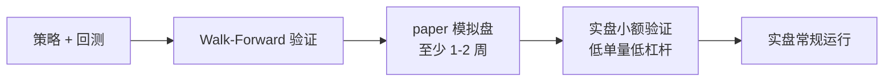

# 模拟盘与实盘

## Worker 系统

paper / live 由 `worker_system`（`StrategyManager` 核心单例）统一管理：

- 策略生命周期管理（注册、启动、停止）
- 注入 exchange adapter 与 risk engine
- 泵线程实时驱动行情，桥接历史数据与实时数据

```python
from worker.strategy_manager import worker_system

worker_system.engine_status()          # 引擎状态（exchange / mode / risk / 策略数）
worker_system.register_strategy(...)   # 注册策略
worker_system.list_strategies()        # 策略列表
```

## paper 与 live 只差一层

paper / live 也跑统一内核主回路，与回测的唯一差异是 **ExecutionSink**：

| 模式 | 数据源 | ExecutionSink | 特点 |
|------|--------|---------------|------|
| backtest | 历史 K 线回放 | `BacktestSink` | 撮合在本地，确定性结果 |
| paper | 实时行情（KernelPump） | `PaperSink` | 模拟撮合，验策略不验资金 |
| live | 实时行情（KernelPump） | `LiveSink` | 真实下单，真实性最高 |

事件回调把 snapshot 推送到前端，实现实时监控。

> 机制上 paper 与 live 走相同的信号、风控、订单表达；真正的差异在**资金的真实性**
> 与**成交的真实性**。

## 风控与风险引擎

实盘前必须配置风险引擎（`worker/` 内注入）：

- 交易风险指标监控（回撤、敞口、频率）
- 止损与持仓风控
- 一切订单先过风控，再进交易所

## 凭证管理

交易所 API 密钥**加密入库**，通过 CLI 统一管理：

```bash
quantcell account add            # 交互式录入（exchange / api_key / secret）
quantcell account list           # 查看已配置的凭证（密钥脱敏显示）
```

安全约束：

- 密钥永不以明文落盘或写日志
- 日志系统结构化输出，敏感字段自动过滤
- 交易所侧建议只授予交易权限，关闭提币权限

## 上线路径建议



每一步都有明确的通过标准（如 paper 期回撤可控、滑点在预期内），再进入下一步。

## 监控与可观测

- **Prometheus 指标**：`/metrics` 端点（能力开关开启时）
- **健康检查**：`/health`
- **前端实时推送**：策略状态、持仓、成交通过 WebSocket 快照可见
- **结构化日志**：带 request_id，便于追踪单次操作全链路（见[日志规范](../best-practices.md)）
