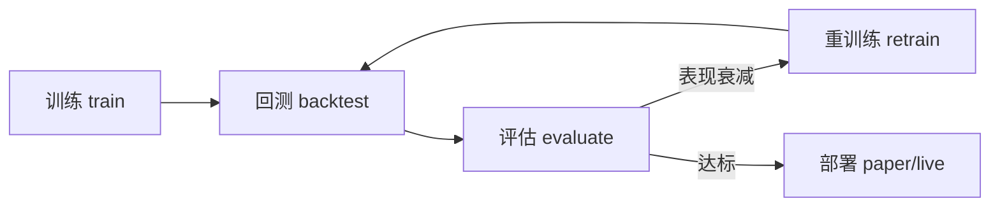

# 强化学习

## 组成

- **Gymnasium 交易环境**：内置的量化交易 Gym，把行情序列、仓位、盈亏建模为
  MDP（状态 / 动作 / 奖励）
- **Stable-Baselines3 2.9**：PPO / SAC / DQN 等主流算法开箱即用
- **RL 服务**：训练、回测、评估、重训练全生命周期管理（`backend/rl/`）

## 训练环境

```python
from axon_quant.rl import TradingEnv
from stable_baselines3 import PPO

env = TradingEnv(config={...}, action_space="discrete",
                 market_data=df, reward="sharpe")
model = PPO("MlpPolicy", env)
model.learn(total_timesteps=10_000)
```

- `action_space`：`discrete`（离散动作）或连续空间
- `reward`：内置 Sharpe、收益、回撤惩罚等多种奖励函数

## CLI 训练

```bash
quantcell rl train \
    -s BTCUSDT \
    -a ppo \
    -t 100000 \
    -r sharpe
```

| 参数 | 说明 |
|------|------|
| `-s` | 交易对 |
| `-a` | 算法：ppo / sac / dqn |
| `-t` | 训练总步数 |
| `-r` | 奖励函数 |

## 一键生命周期

```bash
quantcell rl lifecycle -s BTCUSDT --train-steps 30000 --retrain-steps 10000
```

生命周期覆盖完整闭环，支持 Walk-Forward 验证：



## 注意事项

- RL 策略对过拟合更敏感，**必须**用 Walk-Forward 验证（见[回测详解](backtesting.md)）
- 训练数据与验证数据严格分离，避免信息泄漏
- 奖励函数设计决定策略行为风格，先用简单奖励跑通再加复杂约束
