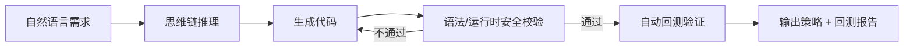

# 策略开发全流程

QuantCell 提供三条策略开发路径，最终都收敛到同一输出契约（`on_bar → Action`）与同一回测引擎：

1. **AI 生成**（推荐）：自然语言描述 → 自动生成、校验、回测
2. **策略模板**：内置 13 种模板，改参数即用
3. **自定义开发**：继承基类，完全手写

## 策略输出契约

所有策略实现同一个接口：每根 K 线收盘时被调用一次，返回一个 `Action`。

```python
from axon_quant import Action, ActionType

class MyStrategy:
    def on_bar(self, bar: dict) -> Action:
        self.closes.append(bar["close"])
        # ... 计算信号 ...
        return Action(ActionType.Buy, 0.8, 0.1, model_id="my_strategy",
                      inference_time_us=0)
```

`ActionType` 共五种：`Buy` / `Sell` / `Hold` / `ReduceLong` / `ReduceShort`。
`target_position` 是目标仓位占权益的比例，由执行层换算为绝对数量。

## 路径一：AI 生成

命令行：

```bash
quantcell strategy generate \
  --requirement "基于双均线的趋势跟踪策略，快线 10 天、慢线 30 天，金叉买入、死叉卖出" \
  --name dual_ma
```

前端：在对话界面直接描述策略想法，AI Agent 同样走生成流水线。

系统内部执行：



安全校验会拒绝危险代码（文件写入、网络访问、循环导单等），未通过校验的代码不会落地。

## 路径二：策略模板

内置 13 种策略模板位于 `backend/strategy/templates/`：

| 模板 | 说明 |
|------|------|
| `dual_ma.py` | 双均线交叉 |
| `sma_crossover.py` | SMA 交叉 |
| `grid.py` | 网格交易 |
| `mean_reversion.py` | 均值回归 |
| `momentum.py` | 动量 |
| `trend_follow.py` | 趋势跟踪 |
| `cascade_signal.py` | 级联信号 |
| `cross_sectional.py` | 截面策略 |
| `factor_timing.py` | 因子择时 |
| `funding_arbitrage.py` | 资金费率套利 |
| `llm_signal.py` | LLM 信号 |
| `martingale.py` | 马丁格尔 |
| `mean_reversion_rl.py` | RL 均值回归 |

模板可直接以参数化方式回测：

```python
from backtest.engine_service import EventDrivenBacktestService
from backtest.data_provider import BacktestDataProvider

service = EventDrivenBacktestService(BacktestDataProvider())
result = service.run_backtest(
    strategy_name="dual_ma",
    strategy_params={"fast": 10, "slow": 30},
    symbols=["BTCUSDT"],
    timeframes=["1h"],
    engine_config={"initial_capital": 100_000},
    data_type="kline",
    market="spot",
)
```

## 路径三：自定义开发

自定义策略放在 `backend/strategies/<策略名>/`，每个策略一个独立目录，
不要放到其他目录（框架按目录发现策略）。

开发要点：

- 实现 `on_bar(bar: dict) -> Action`；bar 为纳秒时间戳 K 线字典
- 策略内部只做**信号计算**，不下单、不访问网络 —— 订单撮合与风控由引擎负责
- 参数通过 `strategy_params` 传入，保持策略无状态或仅保留滑动窗口

## LLM 策略：录制与回放

`mode='llm'` 的策略在回测中**禁止真实请求 LLM**：

- paper / live 运行时，`RecordingProvider` 自动录制 LLM 决策到 JSONL
  （默认目录 `backend/data/llm_replay`，可用 `QUANTCELL_LLM_REPLAY_DIR` 重定向）
- 回测时 `ReplayProvider` 只从录制记录查表，**未命中直接抛错**，不降级为启发式或 Hold

这保证回测结果确定、可复现，且不产生 LLM 调用费用。

## 验证闭环

策略落地的标准流程：

```bash
quantcell strategy list                      # 确认策略已注册
quantcell backtest run -s my_strategy \
  --symbols BTCUSDT --timeframes 1h          # 基础回测
```

进一步使用 Walk-Forward 验证与超参优化（见[回测详解](backtesting.md)），
通过后再进入 [paper → live](live-trading.md) 流程。
